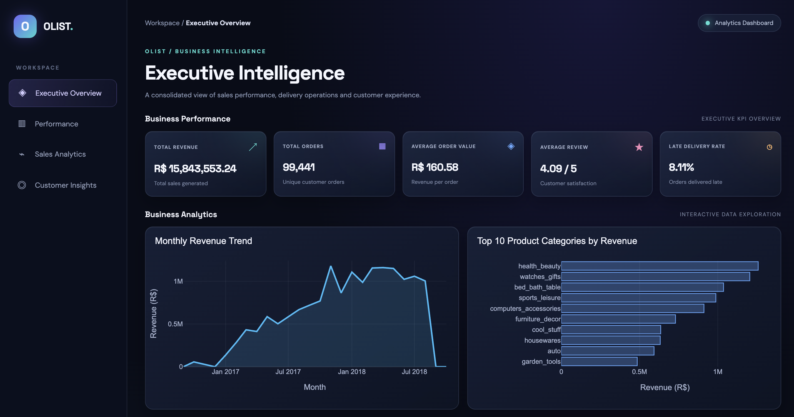

# Olist E-Commerce Analytics
### End-to-End Business Intelligence & Customer Analytics Project

<p align="center">
  <strong>Turning E-Commerce Data into Business Intelligence</strong>
</p>

<p align="center">
  
  
  
  
  
  
</p>

---

## 01. Executive Summary

E-commerce businesses generate enormous volumes of transactional data, but raw data alone cannot explain business performance or support strategic decisions.

This project presents an end-to-end analysis of the **Brazilian E-Commerce Public Dataset by Olist**, transforming raw marketplace data into actionable business intelligence.

Using Python, SQL, statistical analysis, machine learning, and interactive visualization, the project investigates revenue performance, customer purchasing behavior, product categories, payment patterns, seller performance, and delivery operations.

The final deliverable is an interactive executive dashboard supported by analytical findings and business recommendations.

## 02. Business Objectives

The project addresses the following business questions:

- How is revenue performing over time?
- Which product categories and sellers generate the most revenue?
- Which Brazilian states contribute the most to marketplace sales?
- When are customers most likely to place orders?
- Which payment methods dominate customer transactions?
- How does delivery performance influence customer satisfaction?
- Which customer segments should receive targeted marketing campaigns?

## 03. Dataset Overview

**Source:** Brazilian E-Commerce Public Dataset by Olist.

The analysis uses nine interconnected CSV datasets.

| Dataset | Records |
|---|---:|
| Customers | 99,441 |
| Orders | 99,441 |
| Order Items | 112,650 |
| Payments | 103,886 |
| Reviews | 99,224 |
| Products | 32,951 |
| Sellers | 3,095 |
| Category Translation | 71 |
| Geolocation | 1,000,163 |

The datasets contain information about customers, orders, products, sellers, payments, reviews, delivery, and geographic locations.

*Note: Raw dataset files are not included in this repository.*

## 04. Technology Stack

| Area | Tools |
|---|---|
| Programming | Python |
| Data Manipulation | Pandas, NumPy |
| Database & Querying | SQLite, SQL |
| Data Visualization | Matplotlib, Seaborn, Plotly |
| Machine Learning | Scikit-learn |
| Development Environment | Google Colab, Jupyter Notebook, VS Code |
| Version Control | Git, GitHub |

## 05. Analytical Workflow

The project follows a structured analytics workflow.

### Phase 1 — Data Loading & Understanding

- Developed a reusable, object-oriented Python DataLoader.
- Loaded and validated nine datasets.
- Inspected dataset dimensions, column types, and missing values.
- Examined relationships between the datasets.

**Implementation:** `src/data_loader.py`

### Phase 2 — SQL Business Analysis

Created an in-memory SQLite database and performed nine business analyses.

| Query | Business Analysis |
|---|---|
| 01 | Monthly Revenue Analysis |
| 02 | Top 10 Revenue-Generating Categories |
| 03 | State-Wise Customer and Revenue Analysis |
| 04 | Average Delivery Time by State |
| 05 | Late Delivery vs Customer Reviews |
| 06 | Payment Methods and Installment Analysis |
| 07 | Customer Ordering Patterns |
| 08 | Average Review Score by Product Category |
| 09 | Seller Revenue Ranking |

**SQL concepts:** JOIN, LEFT JOIN, GROUP BY, HAVING, ORDER BY, CASE WHEN, CTEs, aggregate functions, and date functions.

**Implementation:** `sql/queries.sql`

### Phase 3 — Data Cleaning & Feature Engineering

Performed data preparation to create an analysis-ready dataset.

Key activities:

- Missing-value treatment.
- Duplicate record checks.
- Product category translation.
- Data type preparation.
- Feature engineering.

Six analytical features were created:

| Feature | Description |
|---|---|
| `delivery_days` | Actual delivery duration |
| `is_late` | Late delivery indicator |
| `order_month` | Order month |
| `order_weekday` | Day of the week |
| `order_hour` | Order purchase hour |
| `total_order_value` | Total order value |

### Phase 4 — Exploratory Data Analysis

Developed 10 visualizations to investigate marketplace performance.

The analysis covers:

- Revenue trends.
- Product category performance.
- Geographic sales distribution.
- Customer purchasing patterns.
- Payment behavior.
- Delivery performance.
- Customer review scores.
- Seller performance.

### Phase 5 — Customer Segmentation

Applied RFM (Recency, Frequency, Monetary) analysis to understand customer value and purchasing behavior.

**Methodology:**

1. Calculated Recency, Frequency, and Monetary metrics.
2. Standardized customer features using StandardScaler.
3. Evaluated cluster selection using the Elbow Method.
4. Applied K-Means clustering with five clusters.
5. Interpreted customer segments and developed marketing strategies.

**Identified customer segments:**

- High-Value Customers
- Recent Low-Spend Customers
- Premium High-Spend Customers
- At-Risk Customers
- Lost Customers

The segments provide a foundation for differentiated customer engagement and retention strategies.

### Dashboard Preview



*Interactive executive dashboard built using Plotly.*

**Key Performance Indicators**

| KPI | Result |
|---|---:|
| Total Revenue | R$15,843,553.24 |
| Total Orders | 99,441 |
| Average Order Value | R$160.58 |
| Average Review Score | 4.09 / 5 |
| Late Delivery Rate | 8.11% |

**Dashboard visualizations:**

1. Monthly Revenue Trends
2. Top Product Categories by Revenue
3. State-Wise Order Distribution
4. Delivery Performance vs Customer Reviews
5. Payment Method Distribution
6. Customer Segmentation Analysis

**[View Interactive Executive Dashboard](dashboard/dashboard.html)**

### Phase 7 — Business Insights & Recommendations

Converted analytical findings into business-oriented insights and strategic recommendations.

## 06. Key Business Insights

| Metric | Finding |
|---|---:|
| Marketplace Revenue | R$15.84 million |
| Total Orders | 99,441 |
| Average Order Value | R$160.58 |
| Average Review Score | 4.09 / 5 |
| Late Delivery Rate | 8.11% |
| Credit Card Payment Share | 78.3% |
| Highest-Volume Weekday | Monday |
| Monday Orders | 16,196 |
| Busiest Ordering Hour | 16:00 |
| Orders at 16:00 | 6,675 |

### Delivery and Customer Satisfaction

Delivery performance has a strong relationship with customer satisfaction:

- On-time deliveries received an average review score of **4.29**.
- Late deliveries received an average review score of **2.57**.

This highlights the importance of delivery reliability in improving customer experience.

## 07. Strategic Recommendations

Based on the analysis, the following business actions are recommended:

**1. Improve Delivery Operations**

Monitor delayed shipments, identify operational bottlenecks, and improve delivery reliability to protect customer satisfaction.

**2. Strengthen Customer Retention**

Develop targeted campaigns for high-value, at-risk, and lost customer segments.

**3. Optimize Marketing Campaign Timing**

Use weekday and hourly purchasing patterns to schedule promotional campaigns more effectively.

**4. Improve Product and Seller Performance**

Monitor category-level revenue and seller contribution to identify growth opportunities and underperforming areas.

**5. Optimize Payment Experience**

Use payment distribution insights to improve checkout experience and payment strategy.

## 08. Repository Structure

```text
olist-ecommerce-analytics/
│
├── dashboard/
│   └── dashboard.html
│
├── data/
│
├── images/
│
├── notebooks/
│   ├── 01_data_understanding.ipynb
│   ├── Olist_E-Commerce_Analytics.ipynb
│   └── README.md
│
├── reports/
│
├── sql/
│   └── queries.sql
│
├── src/
│   ├── __init__.py
│   └── data_loader.py
│
├── .gitignore
├── requirements.txt
└── README.md
```

## 09. Installation & Execution

### Clone the repository

```bash
git clone https://github.com/moubani-dev/olist-ecommerce-analytics.git
```

### Navigate to the project

```bash
cd olist-ecommerce-analytics
```

### Create a virtual environment

```bash
python -m venv .venv
```

### Activate the environment

**macOS / Linux**

```bash
source .venv/bin/activate
```

**Windows**

```bash
.venv\Scripts\activate
```

### Install dependencies

```bash
pip install -r requirements.txt
```

### Prepare the dataset

Download the Brazilian E-Commerce Public Dataset by Olist and place the required CSV files in the expected project data directory.

### Run the analysis

Open the notebook:

`notebooks/Olist_E-Commerce_Analytics.ipynb`

Run the notebook cells in sequence.

The interactive dashboard can also be opened directly:

`dashboard/dashboard.html`

## 10. Project Deliverables

- Reusable object-oriented Python DataLoader.
- Nine SQL business analysis queries.
- Data cleaning and feature engineering.
- Ten exploratory data visualizations.
- RFM-based customer segmentation.
- K-Means clustering.
- Interactive executive dashboard.
- Business insights and strategic recommendations.

## 11. Author

**Moubani Das**

Aspiring Data Analyst | Python | SQL | Data Analytics | Business Intelligence

- **GitHub:** [moubani-dev](https://github.com/moubani-dev)
- **Project Repository:** [Olist E-Commerce Analytics](https://github.com/moubani-dev/olist-ecommerce-analytics)

---

<p align="center">
  <strong>From Raw Data to Business Decisions.</strong>
  <br/>
  Built with Python, SQL, and Data Analytics.
</p>